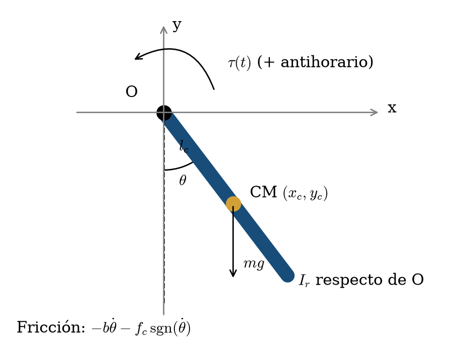
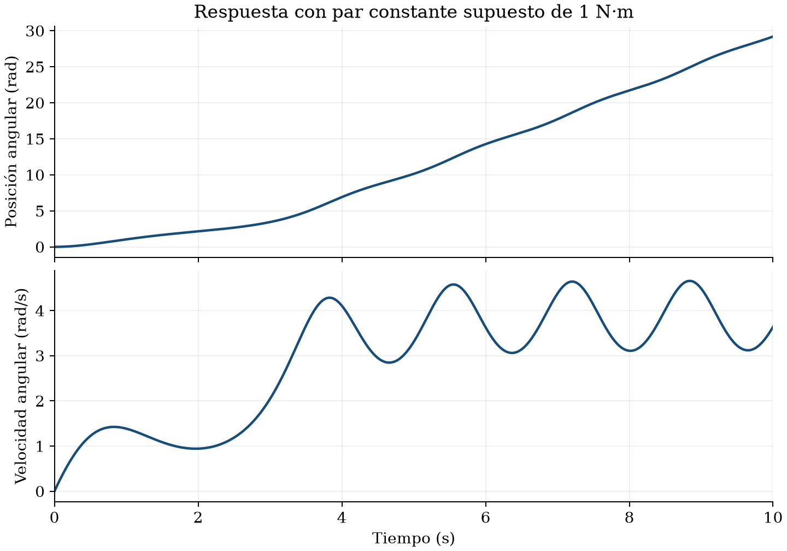

**Modelado y Simulación de Sistemas Mecatrónicos · FIME, UANL · Grupo 004, V6**

[**Abrir notebook con resultados**](AF5_Pendulo_Robot.ipynb) · [**Abrir en Google Colab**](https://colab.research.google.com/github/juandaxx17/AF5_Modelado_2177944/blob/main/AF5_Pendulo_Robot.ipynb) · [**Documento en Prism**](https://prism.openai.com/?u=1eb8506f-eb59-4978-9170-48f4db936aa4&pg=1)

---

Obtener la ecuación dinámica con **Euler–Lagrange**, representar el sistema en **espacio de estados** y simular **posición y velocidad durante 10 segundos**.

| Apartado solicitado | Dónde se encuentra | Estado |
|---|---|---|
| Portada e integrantes | Documento de Prism | Incluido |
| Diagrama, variables y referencia | Notebook §02 y documento | Incluido |
| Desarrollo Euler–Lagrange y fricción | Notebook §03 | Incluido |
| Espacio de estados y condiciones iniciales | Notebook §04 | Incluido |
| Simulación de 10 s y gráficas | Notebook §05 | Ejecutado |
| Resultados y comprobaciones | Notebook §06 | Incluido |
| Conclusión grupal | Documento de Prism y notebook §07 | **Pendiente del equipo** |
| Referencias | Notebook §08 y documento | Incluido |

Origen en la articulación; eje **x** hacia la derecha, eje **y** hacia arriba y ángulo positivo antihorario desde la vertical inferior. Diagrama esquemático, no a escala.

| Parámetro | Valor | Unidad |
|---|---:|---|
| Inercia articular $I_r$ | 0.16 | kg·m² |
| Masa $m$ | 5 | kg |
| Gravedad $g$ | 9.81 | m/s² |
| Distancia al centro de masa $l_c$ | 0.01 | m |
| Fricción viscosa $b$ | 0.14 | N·m·s/rad |
| Fricción de Coulomb $f_c$ | 0.45 | N·m |

**Condiciones iniciales:** $x_1(0)=0$ rad y $x_2(0)=0$ rad/s.

**Supuestos:** par constante de **1 N·m** y ángulo desde la vertical inferior. Se interpreta $I_r$ respecto de la articulación. Estos supuestos deben cotejarse con el ejemplo de clase.

El desarrollo completo está separado en cinco pasos en la notebook: coordenada generalizada, energías, lagrangiano, derivadas y ecuación de movimiento.

$$I_r\ddot{\theta}+b\dot{\theta}+mgl_c\sin\theta+f_c\operatorname{sgn}(\dot{\theta})=\tau(t).$$

Se utilizan **x₁ = θ** y **x₂ = dθ/dt**, con ambos estados inicialmente nulos. La entrada es el par motor. La notebook contiene las ecuaciones explícitas y distingue el modelo no lineal de su aproximación lineal auxiliar.

**Método:** `solve_ivp` / RK45 · **Intervalo:** 0–10 s · **Muestras:** 2001.

La fricción de Coulomb se regulariza mediante `tanh(velocidad / epsilon)`, con `epsilon = 0.001 rad/s`. No representa adherencia estática exacta.

| Magnitud | Resultado |
|---|---:|
| Posición a 10 s | **29.194922 rad** |
| Velocidad a 10 s | **3.638357 rad/s** |
| Velocidad máxima muestreada | **4.654989 rad/s** |

La posición no está envuelta a ±π. El par supuesto produce rotaciones completas; no se aplica un controlador de posición. Se verificaron convergencia, sensibilidad de la regularización, balance energético y reposo sin par motor. Los detalles y salidas están en la notebook.

> **Pendiente del equipo:** redactar la conclusión en Prism y confirmar con el ejemplo de clase el par motor, el origen del ángulo y la referencia de la inercia.

- [Tedrake, R. · Underactuated Robotics: The Simple Pendulum](https://underactuated.mit.edu/pend.html).
- [SciPy · Documentación oficial de solve_ivp](https://docs.scipy.org/doc/scipy/reference/generated/scipy.integrate.solve_ivp.html).

### Cómo ejecutar
1. Instalar las dependencias: `pip install -r requirements.txt`.
2. Abrir la notebook en Jupyter o Google Colab.
3. Ejecutar todas las celdas en orden.

Las salidas y gráficas guardadas corresponden a los parámetros indicados. Las comprobaciones verifican convergencia, sensibilidad de la regularización, balance energético y reposo sin par motor.

### Archivos del repositorio

| Archivo | Contenido |
|---|---|
| [`AF5_Pendulo_Robot.ipynb`](AF5_Pendulo_Robot.ipynb) | Desarrollo, código, gráficas y resultados guardados |
| [`simulacion_af5.py`](simulacion_af5.py) | Cálculo reproducible como programa Python |
| [`requirements.txt`](requirements.txt) | Dependencias |
| `assets/` | Diagrama, gráficas y encabezados del documento |
